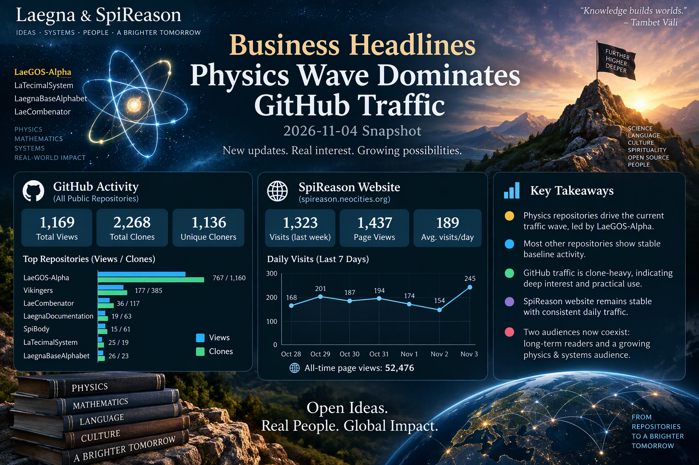

 

---

Neocities [Home](https://spireason.neocities.org) - last 7 days; github [Open Source](https://github.com/tambetvali) - last 14 days.

# Business Headline Analysis
## 2026-11-04 Snapshot: Physics Wave Dominates GitHub Traffic

This report compares the newest GitHub and SpiReason traffic data with the historic pattern observed across previous BusinessHeadlines reports. The current period is unusual because traffic is concentrated around actively updated physics-oriented repositories, while most other repositories continue to display the long-term baseline audience behavior.

---

# Executive Summary

The strongest observation is that traffic has become heavily concentrated around the newest physics and systems-development repositories.

The dominant repository is now:

1. LaeGOS-Alpha
2. Vikingers
3. LaeCombenator
4. LaegnaDocumentation
5. SpiBody

Unlike earlier periods where attention was more evenly spread among philosophy, logic, spirituality, language, and mathematics projects, the current cycle shows a clear migration toward physics-oriented and systems-oriented material.

The timing also matches recent publication and update activity in:

- LaeGOS-Alpha
- LaTecimalSystem
- LaegnaBaseAlphabet
- LaeCombenator

This strongly suggests that repository updates are currently the primary driver of traffic.

---

# SpiReason Website Statistics

## Last Week

| Metric | Value |
|----------|----------:|
| Visits | 1323 |
| Views | 1437 hits |
| Daily average | 189 visits/day |
| All-time page views | 52,476 |

Daily visits:

| Date | Visits |
|--------|---------:|
| 2026-10-28 | 168 |
| 2026-10-29 | 201 |
| 2026-10-30 | 187 |
| 2026-10-31 | 194 |
| 2026-11-01 | 174 |
| 2026-11-02 | 154 |
| 2026-11-03 | 245 |

Observations:

- Traffic remained remarkably stable.
- Most days stayed between 154 and 201 visits.
- The final day jumped to 245 visits.
- No evidence of a viral spike comparable to the largest GitHub repository surges.
- SpiReason continues functioning as a persistent baseline traffic source rather than an event-driven platform.

Compared to historic reports, the website appears increasingly mature:

- fluctuations are smaller,
- average traffic remains sustained,
- sudden collapses are absent.

This resembles an established readership rather than exploratory discovery traffic.

---

# GitHub Global Statistics

Aggregated GitHub statistics show:

- 1,169 total repository views
- 2,268 total clones
- 1,136 unique cloners

Current GitHub activity is notably clone-heavy.

Historically, many repositories generated views without corresponding repository copies.

This period is different.

Large portions of visitors are directly cloning repositories, suggesting:

- code investigation,
- local study,
- AI training ingestion,
- repository archival,
- development experimentation.

---

# Event Traffic vs Baseline Traffic

The current reporting window is divided into two very different layers.

## Layer 1: Event Traffic

These repositories are currently affected by recent updates.

### LaeGOS-Alpha

Views:

- 767 views
- 7 unique viewers

Clones:

- 1160 clones
- 401 unique cloners

This repository alone accounts for:

- ~66% of all recorded views
- ~51% of all recorded clones

Large daily bursts appear on several consecutive days:

- 155 views
- 166 views
- 222 clones
- 242 clones

This is an obvious event pattern rather than baseline growth.

Traffic paths indicate interest in:

- TerminalMode
- LaeGOS-Skydrive
- laegna.json
- Plackotesimal.md
- DataGfx content

The audience appears to be exploring the architecture and data structures behind the system.

---

### LaeCombenator

36 views

117 clones

59 unique cloners

Traffic occurred in a short concentrated burst:

- 34 clones
- 55 clones
- 21 clones

This resembles discovery immediately following publication or revision.

---

### LaTecimalSystem

25 views

19 clones

11 unique cloners

Almost all views arrived on the newest day:

- 25 views on a single day
- 14 clones on the same day

This is a textbook update spike.

---

### LaegnaBaseAlphabet

26 views

23 clones

16 unique cloners

Large activity cluster occurred during the final days:

- 20 views
- 13 clones

This aligns closely with recent discussion surrounding the JSON alphabet structure and symbol organization.

---

# Baseline Repository Layer

After removing recent-update repositories, a different picture emerges.

These repositories continue receiving traffic despite little or no recent promotion.

---

## Vikingers

177 views

385 clones

181 unique cloners

Despite not being the newest active project, Vikingers remains one of the strongest long-term performers.

This confirms:

- persistent interest in worldbuilding
- fantasy mapping
- cultural storytelling
- geographic datasets

Vikingers is currently the largest non-physics traffic source.

---

## SpiBody

15 views

61 clones

32 unique cloners

Although not frequently updated, SpiBody remains one of the strongest baseline repositories.

Interest is concentrated around:

- collective body concepts
- diary content
- growth notes

Its continued traffic suggests an established niche readership.

---

## LaegnaDocumentation

19 views

63 clones

38 unique cloners

Notable paths include:

- BusinessHeadlines itself
- previous statistics reports
- community development notes

This confirms that the statistics archive has become a recurring destination rather than merely internal documentation.

---

## Tambetvali Profile Repository

24 views

43 clones

28 unique cloners

Profile traffic remains healthy.

Common destinations:

- README
- traffic graphs
- profile graphics

This continues functioning as an entry point into the wider repository ecosystem.

---

# Physics Cluster Performance

The strongest thematic cluster is currently physics-related content.

Combined activity appears across:

- LaeGOS-Alpha
- LaTecimalSystem
- LaeCombenator
- LaegnaPhysics
- LaGOS-Physics-Laegna
- LaegnaBaseAlphabet

These repositories collectively produce the overwhelming majority of recent growth.

The pattern differs from historical periods where:

- spirituality dominated,
- symbolic systems dominated,
- AI repositories dominated,
- language repositories dominated.

For the first time, physics and mathematical-system repositories clearly form the center of activity.

---

# Referrer Analysis

External referrers remain limited.

Main sources:

- github.com
- mathforums.com
- aocr.org
- Google

GitHub itself remains by far the strongest traffic source.

This indicates that internal GitHub discovery currently contributes more visitors than outside search engines.

---

# Historic Comparison

Earlier BusinessHeadlines reports generally showed:

- broader distribution
- smaller repository spikes
- stronger influence from SpiReason website traffic

Current report shows a different structure:

- stronger repository concentration
- larger clone numbers
- larger publication-response effects
- stronger GitHub ecosystem activity

The contrast suggests the ecosystem is becoming repository-centric rather than website-centric.

SpiReason remains stable.

GitHub currently supplies the growth wave.

---

# Main Conclusion

The current reporting period is defined by a clear physics-oriented event cycle.

LaeGOS-Alpha acts as the primary growth engine and significantly exceeds every other repository in both views and cloning activity.

When update-driven repositories are removed, the strongest baseline repositories remain:

1. Vikingers
2. LaegnaDocumentation
3. SpiBody
4. tambetvali
5. LaeChing

This suggests two simultaneous audiences now exist:

- A stable long-term readership interested in Laegna, SpiReason, culture, spirituality, worldbuilding, and documentation.
- A newer event-driven audience currently focused on physics, ranked mathematics, system architecture, and LaeGOS development.

The newest traffic wave is therefore not simply larger traffic. It is a shift in topic concentration toward physics and system foundations, while the historical baseline audience continues operating with relatively stable visitation patterns.
