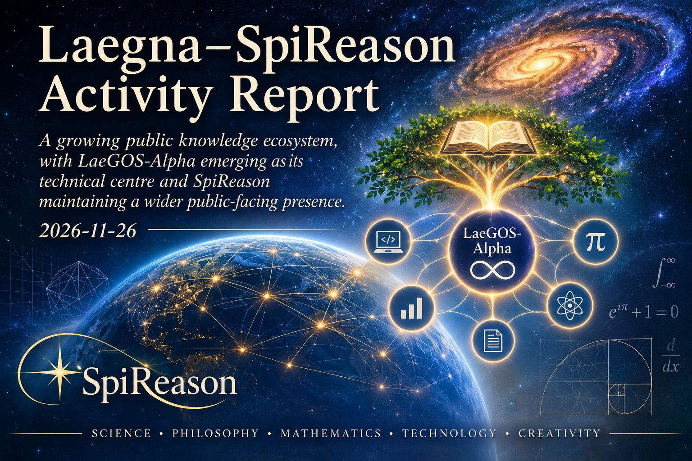

 

---

# Laegna–SpiReason Activity Report — 2026-11-26

> **A growing public knowledge ecosystem, with LaeGOS-Alpha emerging as its technical centre and SpiReason maintaining a wider public-facing presence.**

**Reporting date:** 26 November 2026  
**GitHub reporting window:** Rolling 14 days  
**SpiReason reporting window:** 19–25 November 2026  
**Scope:** `tambetvali` GitHub repositories and [spireason.neocities.org](https://spireason.neocities.org/)

---

## 1. Executive overview: two sides of one ecosystem

The current statistics describe an ecosystem that is becoming increasingly identifiable through its own internal structure.

There are two complementary forms of activity:

1. **SpiReason:** The public-facing website, where visitors encounter the broader intellectual, scientific, philosophical and creative environment.
2. **GitHub:** The technical and documentary layer, where individual projects, mathematical systems, experiments, code, datasets and source materials can be inspected and retrieved.

Neither platform tells the entire story independently.

The website provides an indication of public reach. GitHub provides a more detailed view of which parts of the underlying work attract attention and are being retrieved.

The most significant development in the current reporting period is the concentration of GitHub activity around `LaeGOS-Alpha`, while the broader repository ecosystem continues to receive smaller but distributed activity.

At the same time, SpiReason has maintained a relatively strong weekly audience, recovering somewhat from its early-November average.

### Current headline figures

| Metric | 26 November 2026 |
|---|---:|
| SpiReason weekly visits | 1,468 |
| SpiReason weekly hits | 1,613 |
| SpiReason average daily visits | 210 |
| SpiReason all-time views | 56,689 |
| GitHub repositories represented | 90 |
| GitHub view events | 1,049 |
| GitHub reported unique views, summed per repository | 63 |
| GitHub clone events | 1,470 |
| GitHub reported unique cloners, summed per repository | 857 |
| GitHub repositories with reported views | 28 |
| GitHub repositories with reported clones | 90 |

The GitHub numbers are repository-level measurements, not counts of distinct people across the whole ecosystem.

The figures therefore describe activity, not a verified number of individual followers or users.

---

## 2. SpiReason: a relatively stable public presence

The latest Neocities reporting period covers 19–25 November.

| Date | Hits | Visits |
|---|---:|---:|
| Nov 19 | 298 | 276 |
| Nov 20 | 201 | 163 |
| Nov 21 | 184 | 174 |
| Nov 22 | 181 | 174 |
| Nov 23 | 204 | 195 |
| Nov 24 | 310 | 273 |
| Nov 25 | 235 | 213 |
| **Total** | **1,613** | **1,468** |

The average was approximately 210 visits per day.

Two days stand out: November 19 and November 24.

These days account for a substantial portion of the week's activity, but the remaining days also maintain a meaningful baseline. The website is not dependent on a single isolated traffic event.

### Historical comparison

The previous reporting snapshots provide a useful perspective.

| Reporting period | Weekly visits | Weekly hits | Daily visits |
|---|---:|---:|---:|
| Sep 21–27 | 1,025 | 1,060 | 146 |
| Sep 28–Oct 4 | 1,628 | 1,796 | 233 |
| Nov 3–9 | 1,381 | 1,512 | 197 |
| Nov 19–25 | 1,468 | 1,613 | 210 |

The progression is interesting:

- September showed an established but relatively modest audience.
- The end of September and beginning of October produced a stronger period.
- Early November showed a lower average than the October peak.
- The current week has improved over early November.

Compared with November 3–9:

- Visits increased by approximately 6.3%.
- Hits increased by approximately 6.7%.
- Daily average visits increased from 197 to 210.

Compared with the October peak, the current level is still lower. However, it is considerably above the September baseline.

This suggests a recurring audience with fluctuations rather than a simple continuously increasing traffic curve.

### All-time reach

The previous November 10 report recorded 53,618 all-time views.

The current counter reports 56,689.

That is an increase of 3,071 in the all-time counter between the two observations.

This is a useful indication of continued accumulation, although the all-time counter and the weekly visits are not necessarily identical measurement categories.

### Bandwidth and access patterns

The current seven-day CSV reports approximately 497 MB of transferred bandwidth.

Interestingly, November 19 and 20 account for approximately 386 MB of that total.

This is much more concentrated than the distribution of visits.

It suggests that some days involved considerably heavier content transfer, potentially including images, documents or other resources. The statistics alone cannot identify the exact files or distinguish human downloads from automated retrieval.

The important distinction is that website visits and bandwidth represent different kinds of activity.

A visitor reading a text page and a visitor retrieving several large resources can contribute very differently to these measurements.

**Interpretation:** SpiReason has established a recurring public presence. Its current audience is not at its historical peak, but it is maintaining approximately 200 visits per day, with signs of recovery from the previous reporting period.

---

## 3. GitHub: the technical ecosystem is becoming more concentrated

The GitHub JSON contains activity for 90 repositories.

Across these repositories, the reported totals are:

| Metric | Events | Repository-level unique counts |
|---|---:|---:|
| Views | 1,049 | 63 |
| Clones | 1,470 | 857 |

These numbers have a very different distribution.

For views, the median repository with reported views received only 3 events.

For clones, the median repository received 6 events.

The mean is much higher because a small number of repositories account for a disproportionately large amount of activity.

This is not an evenly distributed audience.

It is a collection of projects with different levels of attention, connected through a common author and intellectual environment.

### Historical GitHub comparison

The previous reporting snapshots show a particularly interesting transition.

| Reporting date | Repositories | Views | Clone events |
|---|---:|---:|---:|
| Sep 27 | ~76 | 229 | 746 |
| Oct 5 | 67 | 571 | 872 |
| Nov 10 | 90 | 1,486 | 2,416 |
| Nov 26 | 90 | 1,049 | 1,470 |

The repository count and reporting windows should be considered when comparing these figures.

Nevertheless, the direction is clear:

- September had comparatively modest activity.
- October showed an increase.
- November 10 recorded a substantial activity peak.
- November 26 shows a decline from that peak, while retaining considerably more activity than the earlier September and October snapshots.

Between November 10 and November 26:

| Metric | Nov 10 | Nov 26 | Change |
|---|---:|---:|---:|
| Views | 1,486 | 1,049 | -29.4% |
| Clones | 2,416 | 1,470 | -39.2% |

This is not evidence that the ecosystem is disappearing.

It is evidence that the previous period contained a particularly strong burst of activity.

A more useful question is where the activity has settled and which projects continue to attract attention.

---

## 4. LaeGOS-Alpha: the current technical centre

The most important individual result is `tambetvali/LaeGOS-Alpha`.

Its current reporting figures are:

| Metric | Value |
|---|---:|
| Views | 894 |
| Reported unique viewers | 6 |
| Clones | 817 |
| Reported unique cloners | 279 |

LaeGOS-Alpha accounts for:

- Approximately 85.2% of all GitHub view events.
- Approximately 55.6% of all GitHub clone events.
- Approximately 32.6% of the sum of repository-level unique cloners.

The last percentage is not a percentage of distinct people across GitHub. It compares two repository-level aggregates.

Even with that qualification, the concentration is unmistakable.

LaeGOS-Alpha is now the principal technical entry point in the measurable repository activity.

### The previous peak and the present situation

On November 10, LaeGOS-Alpha was already dominant:

| Metric | Nov 10 | Nov 26 |
|---|---:|---:|
| Views | 1,132 | 894 |
| Clones | 1,640 | 817 |
| Reported unique viewers | 8 | 6 |
| Reported unique cloners | 533 | 279 |

The current figures are lower, but the project retains an unusually large share of the overall activity.

Its current clone activity is especially notable because it remains larger than the entire clone count of almost every other individual repository.

This suggests that the project has attracted attention beyond the ordinary browsing of a small personal repository.

However, a clone is not proof that someone has read, understood, executed or adopted the material.

It is best understood as a retrieval event and a potential sign of deeper interest.

### What are people exploring?

The popular paths provide a much more informative picture than the repository's headline statistics alone.

| Repository path | Events | Reported unique |
|---|---:|---:|
| Overview | 80 | 3 |
| `LaeGOS-Skydrive` | 77 | 3 |
| `TerminalMode` | 45 | 3 |
| `Metronomics` | 41 | 3 |
| Repository root | 41 | 2 |
| `TerminalMode/RelationTheory.md` | 34 | 3 |
| `LaeGOS-Skydrive/DataLib` | 27 | 3 |
| `LaeGOS-Skydrive/DataRfx` | 24 | 2 |
| `LaeGOS-Skydrive/DataCore` | 23 | 3 |
| `RanksAndClasses/SextantumPhysics.md` | 18 | 1 |

These are the popular entries returned by GitHub, not a complete breakdown of all repository activity.

Nevertheless, the distribution is revealing.

People are not looking exclusively at a single introductory README.

The activity extends into:

- The SkyDrive document and data structure.
- TerminalMode and relation theory.
- Metronomics.
- DataLib, DataRfx and DataCore.
- SextantumPhysics.

This is a more interesting pattern than a simple popularity count.

It suggests exploration of the internal architecture of the project.

The interest appears to extend from the conceptual structure into its organization, mathematical documentation and machine-readable data.

### The website-to-GitHub connection

LaeGOS-Alpha reports:

| Referrer | Events | Unique |
|---|---:|---:|
| github.com | 63 | 3 |
| spireason.neocities.org | 10 | 1 |

This is direct evidence that the two environments are connected through at least some recorded referral activity.

The website is not merely an unrelated publication alongside the GitHub repositories.

It can act as a gateway into the more technical material.

This is consistent with the intended relationship between SpiReason and Laegna: the public-facing environment introduces a broader intellectual framework, while GitHub exposes the underlying material for inspection and reuse.

---

## 5. The wider repository ecosystem: smaller projects still matter

LaeGOS-Alpha dominates the current statistics, but the remaining repositories should not be dismissed.

Several other projects have notable clone activity.

### Repositories with the most clone activity

| Repository | Clone events | Reported unique cloners |
|---|---:|---:|
| LaeGOS-Alpha | 817 | 279 |
| TalesAndStoriesOfMeAndAnAI | 49 | 28 |
| FrequencyCalculator | 25 | 24 |
| LaegnaDocumentation | 24 | 21 |
| tambetvali | 20 | 15 |
| LaeGOS-Drivers-LaeAutomate | 18 | 18 |
| LaeArve | 14 | 12 |
| Vikingers | 14 | 11 |
| LaegnaAIExperiments | 13 | 11 |
| LaegnaAIHooksAndBones | 12 | 11 |
| LaegnaPracticalAI | 12 | 11 |
| LaegnaAIBasics | 11 | 11 |
| LaegnaPhysics | 11 | 9 |
| SpiBody | 10 | 8 |
| LaeCombenator | 9 | 8 |

The numbers show that the ecosystem has several different points of attraction.

Some projects are mathematical, some computational, some philosophical or literary, and others are practical AI experiments.

This diversity is important.

The ecosystem is not simply a single repository with a large number of subordinate files. It has multiple independent projects that can be discovered and retrieved separately.

### FrequencyCalculator

FrequencyCalculator deserves particular attention because it was an important earlier activity centre.

In the September 27 snapshot, it recorded approximately 143 clone events and 70 repository-level unique cloners.

By October 5, it had reached 316 clone events and 148 reported unique cloners in the corresponding reporting snapshot.

In the current period it records:

- 25 clone events.
- 24 reported unique cloners.

This is a substantial reduction from its earlier peak.

It does not mean the project has become irrelevant.

Rather, it illustrates a change in the distribution of attention.

The earlier activity was more strongly associated with individual tools and practical projects. The current activity is much more concentrated around the larger LaeGOS-Alpha environment.

This could reflect a change in what people discover first, what they consider worth retrieving, or which projects are currently receiving attention.

It is not possible to determine the exact cause from traffic statistics alone.

### TalesAndStoriesOfMeAndAnAI

This repository has 49 clone events and 28 reported unique cloners.

It is the second-largest repository by clone-event count.

This is interesting because it demonstrates that attention is not restricted to the mathematical and computational side of the ecosystem.

Narrative and experimental creative work also has a measurable audience.

The relationship between mathematical reasoning, AI experimentation and creative storytelling remains visible in the repository distribution.

### LaeGOS-Drivers-LaeAutomate

This project records 18 clone events and 18 reported unique cloners.

It is a comparatively small absolute number, but the ratio is notable.

It suggests a different pattern from LaeGOS-Alpha: a smaller number of retrievals, with each recorded event associated with a distinct repository-level cloner.

This may be useful to watch as the technical ecosystem develops more practical and reusable components.

### LaegnaDocumentation

The documentation repository records:

| Metric | Value |
|---|---:|
| Views | 21 |
| Reported unique viewers | 9 |
| Clones | 24 |
| Reported unique cloners | 21 |

The path statistics are especially interesting.

| Path | Events | Reported unique |
|---|---:|---:|
| Overview | 6 | 6 |
| `BusinessHeadlines/2026-11-10.md` | 4 | 4 |
| `BusinessHeadlines` directory | 4 | 4 |
| `BusinessHeadlines/2026-05-26.md` | 2 | 2 |
| `BusinessHeadlines/2026-08-04.md` | 1 | 1 |
| `BusinessHeadlines/2026-10-05.md` | 1 | 1 |

This is a particularly encouraging detail.

The statistical reports themselves are being inspected.

The previous reports are not simply archival documents without measurable activity. They form part of the material that people explore in the documentation repository.

This creates a small feedback loop:

1. The ecosystem produces activity.
2. The activity is measured.
3. The results are documented.
4. The documentation itself receives visits and retrievals.

The statistics therefore become part of the ecosystem's public history.

---

## 6. Mathematical, scientific and conceptual repositories

Several other repositories deserve attention because their activity indicates that the broader Laegna structure remains discoverable.

### LaeArve

Current figures:

- 13 views.
- 7 reported unique viewers.
- 14 clones.
- 12 reported unique cloners.

Its referrers include SpiReason and GitHub itself.

The path distribution includes:

- `Books/DaisyElise`
- `Books/LaegnaFerry`
- `Books/LaegnaNumber/Preliminary/LaegnaFantasy`
- README and index documents.

This suggests that the repository is being explored as a collection of materials rather than only through its landing page.

### LaeSpiEssentialTheorems

Current figures:

- 10 views.
- 3 reported unique viewers.
- 7 clones.
- 7 reported unique cloners.

The popular paths include the theorem collection and several subdirectories concerning:

- Infinity and zero.
- Discrete infinities.
- Octave symmetry.
- Projective infinities.
- Quantitative infinities.

This is interesting because it represents a different type of engagement from LaeGOS-Alpha.

The former is more explicitly organized around mathematical statements and their development.

The latter is a larger environment containing multiple connected structures.

### LaegnaPhysics

Current figures:

- 2 views.
- 1 reported unique viewer.
- 11 clones.
- 9 reported unique cloners.

This is a good example of why repository views and clones should not be treated as interchangeable.

The repository has relatively little recorded browsing activity but more clone activity.

Possible explanations include direct cloning, navigation from elsewhere, or other retrieval patterns.

The statistics do not establish which explanation is correct.

### LaegnaAIExperiments and LaegnaAITraining

LaegnaAIExperiments records 10 views and 13 clones.

LaegnaAITraining records 6 views and 9 clones.

Their popular paths include experimental code and documentation concerning:

- Onlinear.
- Complexity control.
- Compression.
- Rhythym.
- Q&A and agnostic training material.

These repositories indicate that the AI side of the ecosystem is not limited to LaeGOS-Alpha.

There is a separate body of experimental and practical work.

### SpiBody

SpiBody records:

- 3 views.
- 2 reported unique viewers.
- 10 clones.
- 8 reported unique cloners.

This is a relatively small but distinct signal.

The soma-oriented and practical body-work material remains part of the wider ecosystem, even though the current measurable attention is more concentrated on mathematical and computational projects.

---

## 7. What the daily activity suggests

The daily GitHub arrays provide another layer of information.

LaeGOS-Alpha's 14-day view series is:

`123, 155, 151, 159, 145, 112, 27, 2, 4, 16, 0, 0, 0, 0`

Its clone series is:

`62, 40, 186, 170, 90, 58, 142, 47, 8, 5, 5, 2, 1, 1`

The exact array order is the order returned by GitHub.

The important observation is the large difference between the earlier and later portions of the reporting window.

The first part contains substantial activity, while the later part is much quieter.

This explains why the rolling totals remain high even though the most recent days do not show equivalent activity.

It also warns against interpreting a 14-day total as a measurement of the current daily rate.

A repository can have a strong two-week total because of an earlier burst.

This is particularly relevant for LaeGOS-Alpha.

Its current position is strong, but the recent daily pattern suggests that the earlier burst is fading.

The broader ecosystem may therefore be entering a period in which the results of that burst become more important than the burst itself.

The next question is whether people continue exploring the material, whether the interest moves toward other repositories, and whether the project develops more sustained activity.

---

## 8. The development of the ecosystem over time

Looking across the historical reports, several phases can be distinguished.

### Phase 1 — Establishing a public presence

The September statistics showed that SpiReason already had a recurring audience.

The GitHub ecosystem had several active entry points, with FrequencyCalculator, the profile repository and other projects receiving attention.

The activity was distributed across a comparatively smaller collection of repositories.

The important achievement at this stage was the existence of a discoverable public ecosystem.

### Phase 2 — Increasing visibility and project diversity

The October statistics showed a stronger public website and increased GitHub activity.

FrequencyCalculator became a particularly prominent repository.

LaegnaDocumentation also showed substantial activity.

This period demonstrated that the projects could attract attention independently, not only through the main website.

### Phase 3 — LaeGOS-Alpha becomes the centre

By November 10, LaeGOS-Alpha had become the dominant GitHub project.

The repository's activity was substantially larger than that of the other projects.

Its internal directories and technical documents were also being explored.

This was a significant structural change.

The ecosystem was no longer represented primarily by several separate repositories competing for attention.

A larger technical environment was becoming a common point of entry.

### Phase 4 — Consolidation and a wider public baseline

The November 26 figures show a reduction from the November 10 GitHub peak.

However, the overall activity remains substantially above the earlier September and October snapshots.

LaeGOS-Alpha continues to dominate, while the wider repository ecosystem maintains activity.

SpiReason has also improved over its previous November reporting period.

The current situation therefore looks less like a new explosive growth phase and more like a consolidation period following a significant burst of attention.

---

## 9. What does this mean for Laegna and SpiReason?

The numbers become more meaningful when considered in relation to the actual purpose of the projects.

Laegna is not simply a collection of unrelated programming repositories.

It is an attempt to build a connected environment of mathematical structures, number systems, logic, computational tools, physics-oriented models, symbolic systems and documentation.

SpiReason provides the broader public context in which these developments can be presented and interpreted.

The relationship is important.

A mathematical system can be difficult to approach without its surrounding explanations.

A philosophical or scientific article can remain interesting without requiring anyone to inspect its underlying implementation.

The two environments therefore serve different levels of engagement.

### Three kinds of observable interest

The current data suggests three broad forms of interest.

**1. Public discovery**

SpiReason receives approximately 210 daily visits.

This is the broadest observable public-facing signal.

**2. Technical exploration**

LaeGOS-Alpha attracts the largest concentration of GitHub activity.

The popular paths suggest exploration of its internal organization, relation theory, data structures and mathematical documentation.

**3. Independent project retrieval**

Other repositories continue to receive clones.

FrequencyCalculator, TalesAndStoriesOfMeAndAnAI, LaegnaDocumentation, LaeArve, the AI projects and the practical tools demonstrate that the wider ecosystem is not entirely dependent on one repository.

These three forms of activity are complementary.

They should not be added together as if they represented unique individuals.

---

## 10. What is not established by the statistics?

It is important not to overinterpret the numbers.

The current measurements do not establish:

- How many distinct human beings use the entire ecosystem.
- Whether a person who clones a repository actually reads or uses it.
- Whether every view represents a human visitor.
- Whether clone activity leads to adoption, collaboration or contribution.
- Whether a particular mathematical theory is understood or accepted by visitors.
- Whether website visitors and GitHub visitors belong to the same population.
- Whether traffic increases are organic, automated or associated with external indexing.

GitHub's unique counts are reported independently per repository.

The same individual can appear in multiple repository counts.

Similarly, referrer and path breakdowns contain only popular returned entries and should not be interpreted as complete traffic inventories.

These limitations do not make the data useless.

They establish what kind of conclusions are justified.

The most reliable interpretation is about relative activity, concentration, persistence and changes in the distribution of attention.

---

## 11. What is worth watching next?

Several indicators would be particularly useful in the next reporting periods.

| Indicator | Why it matters |
|---|---|
| LaeGOS-Alpha daily clones | Determines whether the recent burst develops into sustained retrieval |
| LaeGOS-Alpha DataRfx and DataLib paths | Shows whether attention reaches the structured data layer |
| RelationTheory and SextantumPhysics | Indicates continued exploration of deeper mathematical and physics-oriented material |
| LaegnaDocumentation | Shows whether the historical and explanatory layer attracts recurring interest |
| FrequencyCalculator | Helps identify whether earlier tool-oriented activity returns |
| LaeGOS-Drivers-LaeAutomate | Tracks interest in practical technical components |
| SpiReason daily visits | Measures the persistence of the public-facing audience |
| Website bandwidth | Helps distinguish ordinary reading from heavier resource retrieval |

One particularly useful distinction will be whether activity becomes more distributed over time.

If LaeGOS-Alpha remains dominant while other repositories gradually attract more independent activity, that would suggest the development of a recognizable ecosystem around the central project.

If all activity remains concentrated in LaeGOS-Alpha, it would instead indicate that the central repository is still the primary point of discovery.

Both are useful observations, but they describe different stages of development.

---

## 12. Overall assessment

The November 26 statistics tell a reasonably encouraging story, but not one of uninterrupted growth.

SpiReason has maintained a public audience of approximately 200 visits per day.

GitHub has experienced a reduction from its November 10 peak, yet activity remains considerably higher than in the earlier snapshots.

LaeGOS-Alpha has emerged as the clear technical centre of the ecosystem.

Its activity is not limited to its overview page. The reported paths show interest in its internal architecture, mathematical documentation and structured data.

At the same time, the smaller repositories continue to receive attention, including projects outside the central mathematical and computational themes.

This matters because the long-term value of the ecosystem is not necessarily measured by the popularity of one repository.

It is measured by whether the individual projects become interconnected, discoverable and useful in their own right.

The most interesting development is therefore not simply that LaeGOS-Alpha has received hundreds of clones.

It is that there is now a more recognizable relationship between:

- A public-facing scientific and philosophical website.
- A growing collection of independent projects.
- A central technical and mathematical environment.
- Structured data and machine-readable resources.
- An accumulating documentary history.

These components are beginning to appear together in the activity measurements.

### Final perspective

The ecosystem seems to be moving from the stage of publishing individual ideas toward the stage of establishing a connected body of work.

That is a different kind of development.

An isolated article can attract a visitor. A useful tool can attract a clone. A mathematical document can attract someone interested in a particular result.

But a connected ecosystem offers something more: multiple ways to enter, investigate, compare, retrieve and potentially build upon the material.

The current numbers cannot demonstrate that this deeper engagement has already happened.

They do, however, show that the infrastructure for it is becoming increasingly visible.

**SpiReason is the public-facing environment. Laegna is the developing intellectual and technical body. LaeGOS-Alpha is currently its strongest measurable technical centre.**

The next stage is to see whether this concentration of attention becomes sustained engagement with the wider ecosystem.

---

## Data sources and methodology

This report uses the statistics archived alongside the historical reports in:

[LaegnaDocumentation — BusinessHeadlines](https://github.com/tambetvali/LaegnaDocumentation/tree/main/BusinessHeadlines)

Current source files:

- `2026-11-26.csv` — SpiReason Neocities statistics.
- `2026-11-26.json` — GitHub repository statistics.

Historical comparisons:

- `2026-09-27` — earlier baseline.
- `2026-10-05` — October reporting period.
- `2026-11-10` — previous November reporting period.

### Measurement conventions

- `u` denotes a repository-level unique count.
- GitHub traffic covers a rolling 14-day reporting window.
- Neocities statistics cover the reporting period shown in the CSV.
- Repository-level unique counts cannot be summed to calculate unique people across GitHub.
- Referrer and path breakdowns are partial.
- Clones indicate retrieval events, not verified human adoption.
- Historical reports may have different repository counts and reporting windows.

The purpose of this report is to interpret the evolution of the ecosystem, not to treat the available traffic measurements as a census of its users.
