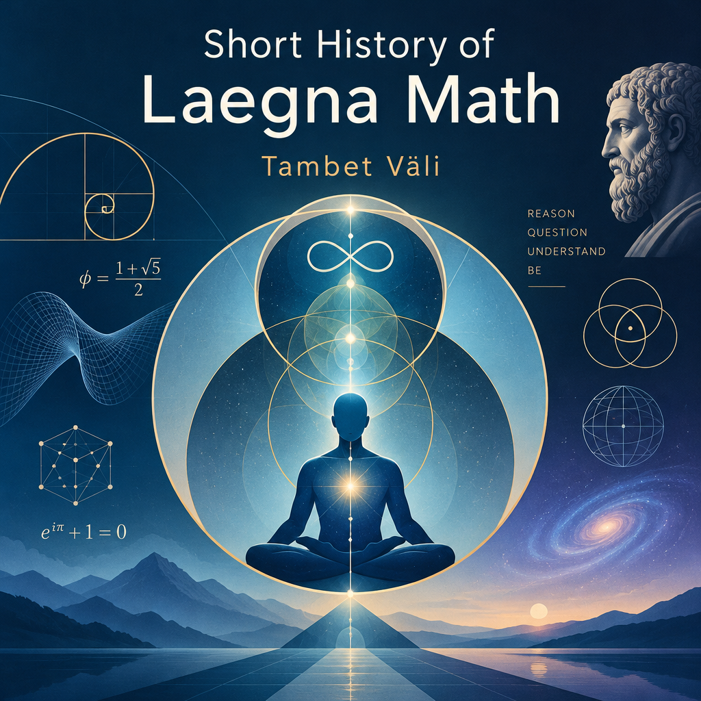

 

# Laegna History

I am Tambet Väli, born at 1983.04.04 in Estonia, Tallinn.
- From 1986, I lived rather at Tallinn; vacations were at Vilsandi island or Kütiorg valley, until I grew up and travelled..
- From 2013, I live at Barcelona.

At ten years old, 1996, I wrote:
- Basic - 10 y
- Pascal - 12? y
- Later I have learnt around 30 languages - the exact number might vary depending on quality.

I was reading a lot until age 6, when I had read most of the favourite books of most people - for most people, all they could ever name or mention seriously;
- Later it was more than ten thousand books; but it shifted to references and documentations, until the last decade I don't read easily; well starting from some time before my travel.

As child I was pondering on infinities, paradoxes, zen, many topics here at Laegna-SpiReason. I was writing and discussing philosophy, science, spirituality - most people would expect I would put them together as science, but lost their enthusiasm slowly.

At Barcelona, some third year - 2016 - I was steadily working on my math, in my mind; in the last 10 years most of the theory is compiled in my mind.
- It started from idea of "Laegna Language" - one which does not contain paradox, and remains robust in regards to infinity and left-wing bookkeeping, flat systems brought dynamic.
- The language development involved heavy math, and currently there is the core of the language, with all the math.
  - Idea is right now, in what is presented: more that letter-wide analysis of existing languages can enchange them to naturally express relations available in paradox.

Laegna website, spireason.neocities.org, has been around for some 3 years now:
- First year, some 3-6 people for week.
- Second year, some 60-80, especially as it culminated.
- This year, it's slowly growing to some 100-200.
- It's still wobbling.

Milestones:
- Sheep Counter 3: in designing the Sheep Counter, some of the wave examples vibrated and exploded; CoPilot said floating point rounding errors - I saw so physical behaviour of imaginary object, mere number in it's wave projection, hints that there is more beneath my math.
- Lately, in 2026 and second half of it: from language -> math, it has started some math -> physics shift.
  - I found out: ideas expressed in math, often naturally exist in physics.

This was short history of Laegna mathematics.
